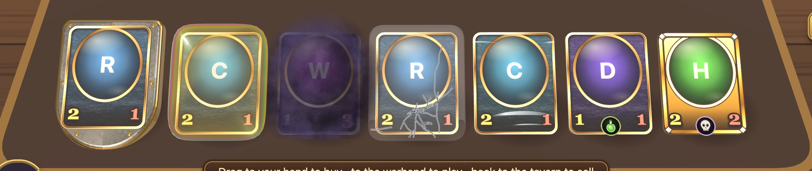
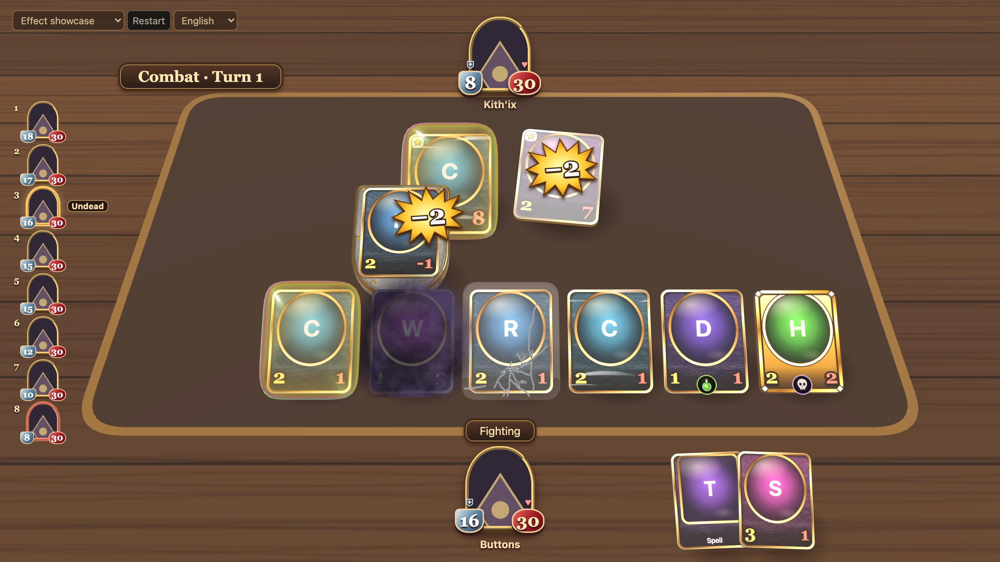
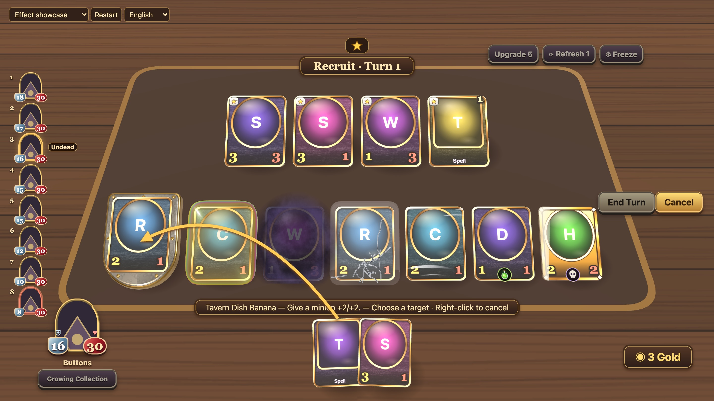
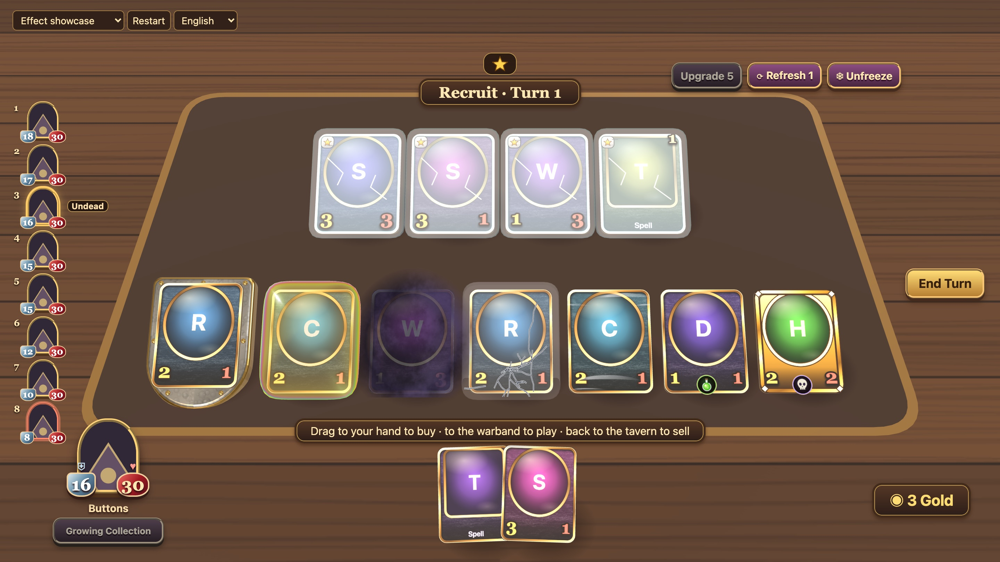
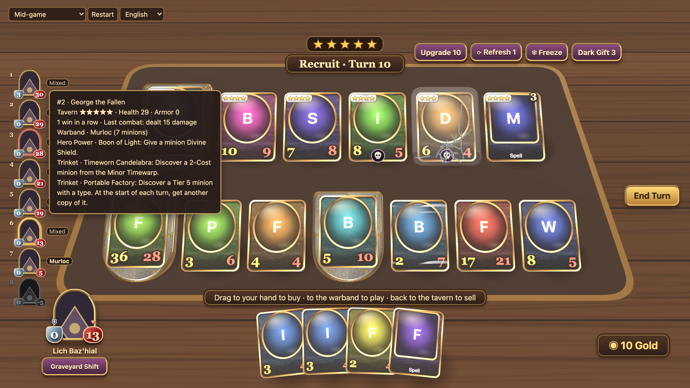

# HSBattlegroundsCounterfeit

[English](README.md) · [简体中文](README.zh-CN.md) · **繁體中文**

個人自用、只在本機執行的酒館戰棋式自走棋。你控制八人對局中的 0 號座位，對手是七個腳本機器人。本地 Python 服務透過 TavernGym 引擎結算規則，瀏覽器裡的 Three.js 棋盤負責呈現招募、戰鬥重播和各種特效。

> **非官方同人專案。** 本專案與暴雪娛樂無關，未獲其認可或贊助。《爐石戰記》及所有卡牌名稱、卡牌文字和美術皆屬暴雪所有。**本儲存庫不包含任何官方卡圖。** 卡圖只能還原到 Git 忽略的資料夾，供個人本機測試使用，詳見[卡圖](#卡圖)。

## 截圖

以下截圖使用 `?noart` 拍攝，不顯示授權卡圖：卡牌顯示佔位插圖，英雄顯示空白頭像。


<table>
<tr><td width="50%"><br>戰團特寫：嘲諷、聖盾、潛行、復生、風怒、劇毒和金色亡語隨從</td><td width="50%"><br>戰鬥重播：嘲諷隨從與聖盾隨從互相攻擊，帶傷害爆星</td></tr>
<tr><td width="50%"><br>指向性法術變成瞄準箭頭</td><td width="50%"><br>凍結的商店</td></tr>
<tr><td width="50%"><br>中盤對局：滑過玩家頭像，顯示名次、上一場陣容、英雄技能和飾品</td><td width="50%"></td></tr>
</table>

## 功能

- **規則引擎：** TavernGym 1.0.0（規則 36.6.3），並套用一個本地修補，用來記錄攻擊命中以及戰鬥前後的英雄狀態，並把引擎的公開視圖開放給 Python。
- **3D 棋盤：** Three.js 把商店、戰團和手牌呈現為持續存在的卡牌物件。拖曳卡牌即可購買、出牌、調整站位和出售。一排卡牌依特效寬度排開，盾牌和氣泡不會蓋住相鄰的卡。
- **卡面：** 程式繪製的黃銅外框和楓木卡身，插圖嵌在玻璃下，配銀色等級徽章，攻擊力和生命值直接以數字顯示。滑過卡牌會顯示名稱、效果，以及附加的卡牌（例如黑暗之賜）。
- **關鍵字特效：**
  - 嘲諷：卡牌站在一面帶鉚釘的厚鋼盾上，整張卡浮起。
  - 聖盾：包住整張卡的深金色氣泡。
  - 潛行：卡面上的煙霧，並溢出卡牌邊緣。
  - 風怒：卡面上下兩帶的氣流。
  - 復生：帶裂紋的霧面玻璃外殼。
  - 亡語、劇毒：卡牌上的徽記。
  - 金色隨從：金色外框和掃光，不依賴顏色也能辨認。
- **互動：**
  - 指向性法術拖出手牌區後變成瞄準箭頭。箭頭從開啟選擇的來源指出：手牌、隨從或英雄技能。
  - 磁力隨從可以吸附到機械上。
  - 棄牌效果可以選擇手牌。
  - 抉擇和發現面板可以收起。
  - 右鍵或 Esc 取消。
- **戰鬥重播：** 在桌面上重播引擎的戰鬥紀錄，包括撲擊、傷害爆星、破盾、陣亡、召喚以及最後的英雄攻擊。戰鬥中手牌保持可見，滑過仍會顯示說明。
- **對手資訊：** 左側玩家列表依生命加護甲排名，每個頭像旁標出該玩家上一場戰鬥陣容的種族。滑過頭像會顯示名次、酒館等級、連勝、英雄技能和飾品。
- **三種語言：** 英文、簡體中文和繁體中文，可以在左上角選單切換，不必重開對局。預設跟隨瀏覽器語言；`?lang=en`、`?lang=zh-CN` 或 `?lang=zh-TW` 可以強制指定。繁體卡牌文字由 OpenCC 從簡體轉換。詳見 [docs/I18N.md](docs/I18N.md)。
- **固定場景：** 可以重現的對局，用來示範特定機制（見下文）。

## 環境需求

已在 macOS（Apple Silicon）、Python 3.11.15、Node.js 25.6.1、npm 11.9.0 上測試。

`vendor/wheels/` 裡附帶的引擎安裝檔只適用於 **macOS arm64**。其他平台需要自行編譯引擎（見[引擎](#引擎)）。

## 安裝

在儲存庫根目錄執行：

```sh
python3.11 -m venv .venv
.venv/bin/python -m pip install -r backend/requirements.txt
npm ci
```

## 執行

在儲存庫根目錄開兩個終端機，分別啟動後端和前端：

```sh
.venv/bin/python -m uvicorn backend.main:app --host 127.0.0.1 --port 8000
```

```sh
npm run dev --workspace frontend
```

打開 <http://127.0.0.1:5173/>。左上角的場景選單可以開始固定場景或隨機對局。API 文件位於 <http://127.0.0.1:8000/docs>。

### 操作

| 動作 | 手勢 |
| --- | --- |
| 購買 | 把商店卡牌拖進手牌，或直接點擊 |
| 打出隨從 | 從手牌拖到戰團，落點跟隨游標 |
| 磁力吸附 | 把磁力隨從放到亮框機械的正中央 |
| 調整站位 | 在戰團內拖曳隨從 |
| 出售 | 把隨從拖回商店 |
| 施放指向性法術 | 拖出手牌區，在亮框目標上放開 |
| 發動隨從或英雄技能 | 點擊；需要時再選擇目標 |
| 取消 | 右鍵、Esc 或「取消」按鈕 |
| 查看說明 | 滑過卡牌或玩家頭像 |

### 場景

| 場景 | 示範內容 |
| --- | --- |
| `target` | 定向施法：對隨從使用香蕉果盤 |
| `recruit` | 購買、打出和調整隨從站位 |
| `triple` | 三連得到金色隨從，並使用三連獎勵（發現） |
| `collision` | 兩個大隨從同時互相命中 |
| `deathrattle` | 聖盾破碎、亡語召喚和風怒 |
| `reborn` | 復生隨從以 1 點生命值回歸 |
| `hero_damage` | 敵方英雄擊碎護甲並造成傷害 |
| `mechanics` | 第 3 回合、10 金幣：磁力、黑暗之賜、抉擇和棄牌發動 |
| `late` | 由機器人打到第 10 回合的對局，用來查看對手的名次、英雄技能和飾品 |
| `showcase` | 一次展示所有關鍵字特效：嘲諷、聖盾、潛行、復生、風怒、劇毒和金色亡語隨從 |

也可以透過 API 建立：`POST /api/games?scenario=deathrattle`。

## 檢查

```sh
.venv/bin/python -m pytest -q
npm run check:frontend
npm run test:frontend
npm run build --workspace frontend
```

## 目錄結構

```text
backend/            FastAPI 服務、遊戲工作階段、場景和測試
frontend/src/       棋盤控制、HUD 和 API 用戶端
frontend/src/core/  與渲染無關的遊戲到介面邏輯（操作判定、戰鬥腳本、關鍵字），有單元測試
frontend/src/three/ Three.js 渲染：舞台、卡牌、戰鬥、特效、貼圖
frontend/test/      前端單元測試（node --test）
scripts/            卡圖還原腳本
vendor/             引擎安裝檔、本地引擎修補、授權條款和 NOTICE
docs/HANDOVER.md    詳細的設計與工程說明
```

## 本地 API

服務把對局保存在記憶體中，重新啟動後重新開局。HTTP 和 WebSocket 共用工作階段與版本號。

| 用途 | 端點 |
| --- | --- |
| 列出場景 | `GET /api/scenarios` |
| 建立對局 | `POST /api/games`（可選 `?scenario=`） |
| 讀取快照 | `GET /api/games/{game_id}` |
| 送出動作 | `POST /api/games/{game_id}/actions` |
| WebSocket | `/ws/games/{game_id}` |

用戶端送出的動作必須原封不動取自最新快照的 `legal_actions`，並附上該快照的 `version` 和新產生的 `request_id`。錯誤碼如下：

- `stale_version`：快照的 `version` 已過期。
- `duplicate_request`：`request_id` 已經用過。
- `illegal_action`：動作不在 `legal_actions` 裡。

所有錯誤回應都附帶目前的快照。TypeScript 用戶端位於 `frontend/src/game-api.ts`。

## 卡圖

沒有卡圖時，卡面會退回為帶底色的徽記。`frontend/src/demo-art.json` 依引擎卡牌 ID 記錄官方圖片來源和固定的 SHA-256。要把圖片還原到 Git 忽略的 `frontend/public/assets/official/`，供**個人本機測試**使用：

```sh
.venv/bin/python scripts/restore_demo_art.py
```

請勿提交或再散布這些圖片。

## 引擎

規則來自 [MCG-NJU/AutoTavern](https://github.com/MCG-NJU/AutoTavern)（TavernGym），固定在 commit `fb61201a557ddd36a411cf44aac51ce4d9b606ce`。

- **附帶的安裝檔：** 套用修補的 `1.0.0+impact3` 版本。
- **引擎修補：** `vendor/taverngym/attack-impact.patch`。
- **建置紀錄：** `vendor/taverngym/build-manifest.json`。

要為其他平台建置，先在該 commit 上套用修補，再依上游流程建置，然後把 `backend/requirements.txt` 指向新的安裝檔。引擎採用 MIT 授權，其中的遊戲內容另由 `vendor/taverngym/NOTICE` 說明。

## 狀態

這是個人使用的概念驗證，沒有帳號、配對或連線對戰。部分引擎系統（任務、夥伴、奧秘等）目前只有通用介面。完整狀況和後續規劃見 `docs/HANDOVER.md`。
